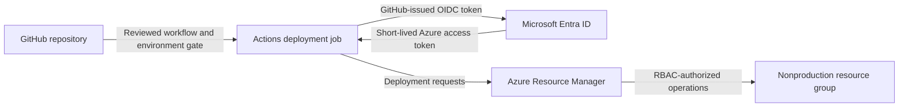

# Threat Model — GitHub Actions to Azure Workload Identity

**Status:** Modeled design and proposed controls. Lab validation and formal design review are pending.

## Scope and decision

Can a GitHub Actions deployment pipeline manage a representative Azure workload without a stored Azure client secret or access beyond its deployment scope? The modeled baseline is a deployment principal that authenticates with a persistent client secret. The proposed design uses GitHub Actions OpenID Connect (OIDC) federation to a dedicated Microsoft Entra application and service principal, with Azure RBAC limited to one nonproduction resource group. AFG's production, workforce, lifecycle, and acquisition scenarios are outside this model. [Issue #42](https://github.com/Bobby360720/cloud-security-architecture-portfolio/issues/42) tracks the broader identity review.

**Traceability:** [Phase 0 traceability matrix](../00-enterprise-assessment/assessment/traceability-matrix.md) links F-004 → R-003 → SEC-002 / SEC-003 / TR-007. [Phase 2 control IAM-02](../02-cloud-governance/compliance/cloud-security-control-framework.md) provides the control objective. [Issue #37](https://github.com/Bobby360720/cloud-security-architecture-portfolio/issues/37) tracks the identity standard, and [Issue #41](https://github.com/Bobby360720/cloud-security-architecture-portfolio/issues/41) tracks federation evidence.

## Data flow and trust boundaries

1. **Repository to runner.** Approved workflow code and pinned dependencies execute in the deployment job. The GitHub environment controls which branches can deploy and applies available approval protections. PR validation jobs have no Azure deployment identity or OIDC token permission.
2. **GitHub to Entra.** Entra matches the token issuer, audience, and subject against the federated credential. The proposed subject binds the repository and deployment environment. The environment subject does not itself enforce branch approval or identify a single workflow, so branch restrictions and workflow change review remain essential.
3. **Entra to Azure authorization.** The runner uses the Azure access token to call Azure Resource Manager. Azure RBAC governs allowed operations and scope. Identity and role administration remain with separate administrators.

**Assets:** Workflow and environment configuration, federated credential and application ownership, runner tokens, deployment permissions, workload resources, and audit evidence.

## Prioritized threats and validation

STRIDE categories describe the threat. Priority reflects modeled impact and exposure before the proposed controls. All checks below are planned.

| ID | Threat and priority | Proposed treatment and owner | Expected check and evidence |
|---|---|---|---|
| TM-01 | **Spoofing · High.** A job from an unintended repository or environment authenticates as the deployment principal. | Identity Security scopes federation to the expected issuer, audience, and repository/environment subject. Platform Engineering restricts deployment branches. | Authorized nonproduction job authenticates. A controlled job with a different environment subject cannot exchange its token. Record redacted run results and the credential configuration. |
| TM-02 | **Tampering · High.** A workflow change or third-party action runs unauthorized deployment code inside the trusted job. | Platform Engineering requires review of workflow changes, pins external actions to reviewed commit SHAs, and grants token permission only to the deployment job. | Review branch and environment protection settings and workflow permissions. Confirm an unapproved change cannot reach deployment under the configured protections. |
| TM-03 | **Elevation of privilege · High.** The deployment identity can change access assignments or modify unrelated workloads. | Cloud Platform grants only the permissions needed for the representative deployment, scoped to one resource group. Separate identity and RBAC administration. | Verify effective assignments, including inherited access. Confirm a permitted operation succeeds and a harmless out-of-scope operation is denied. Verify the identity lacks role assignment permissions. |
| TM-04 | **Information disclosure · High.** Job output or artifacts expose a token usable within its lifetime. | Platform Engineering keeps tokens out of job output, caches, and artifacts. Limit the token-bearing job to reviewed code and isolate deployment from PR jobs. | Inspect workflow handling and sanitized run logs and artifacts. Record results without retaining credentials or tokens. |
| TM-05 | **Repudiation · Medium.** Responders cannot tie a cloud change to a pipeline run and reviewed commit. | SecOps and Platform Engineering correlate GitHub runs, Entra workload sign-ins where available, and Azure Activity Log events. | Record commit and run IDs, service principal, time window, and Azure operation. Document correlation limits and evidence gaps. |
| TM-06 | **Denial of service · Medium.** Federation configuration drift blocks legitimate deployments. | Identity Security documents credential recovery and independently reviews federation changes. Platform Engineering alerts on failed deployments. | Verify a controlled configuration mismatch fails visibly. Restore the approved configuration and record a successful rerun. |

## Design review recommendation

Proceed with an isolated nonproduction validation of the federated design. A stored client secret simplifies compatibility with legacy automation but adds distribution, rotation, and exposure risks. Federation removes the stored deployment secret and shifts control to repository and environment protections, federation configuration, and Azure permissions.

Before proposing production use, validate authorized deployment, unintended-context rejection, and effective RBAC boundaries. Confirm the telemetry available for investigations and document recovery ownership. A compromised authorized job can still act within the identity's effective permissions while its token is valid. Identity Security and Platform Engineering own the proposed treatments. Track any operational residual-risk decision in SharePoint and link supporting architecture and validation evidence in GitHub. Reassess the model when the trusted repository, environment, runner, permissions, or target scope changes.

[Microsoft guidance on GitHub Actions OIDC authentication to Azure](https://learn.microsoft.com/en-us/azure/developer/github/connect-from-azure-openid-connect)
