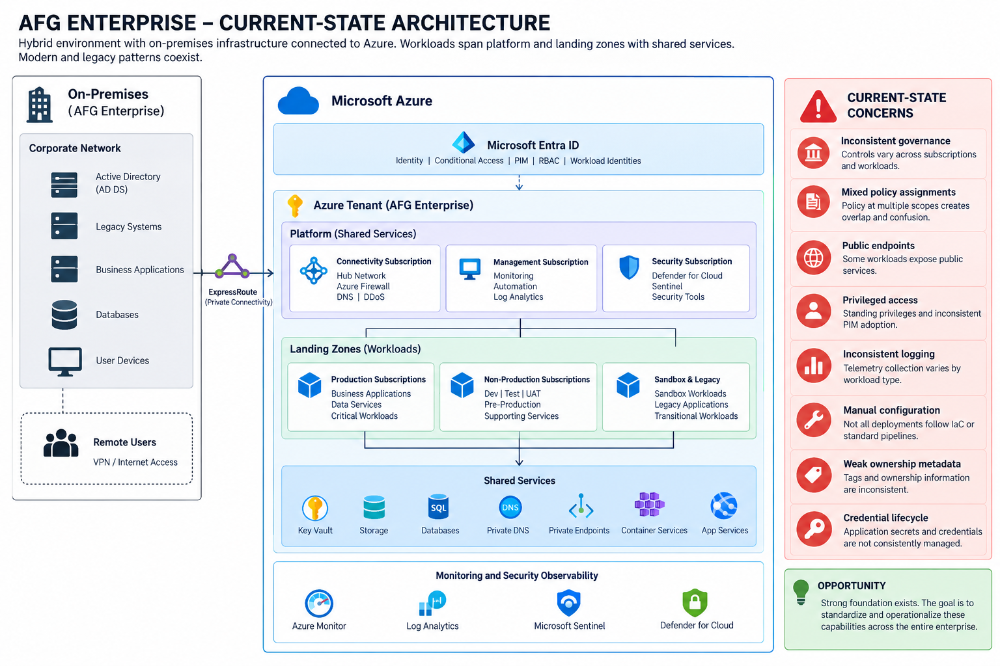

# AFG Enterprise Security Architecture Transformation

**From brownfield assessment to defensible cloud, identity, and information protection architecture.**

An evolving, hands-on enterprise security architecture portfolio using a fictionalized hybrid Azure organization to connect business requirements, architectural decisions, security controls, engineering implementation, and validation evidence across three complementary disciplines: **Cloud Security, Identity Security, and Information Protection**.

**Cloud Security · Identity Security · Information Protection · Zero Trust · Azure · Terraform**

**Current status:** Phase 01 — Azure Landing Zone (in progress). Phase 00 assessment baseline established; selected review and checkpoint items remain open.

[View current assessment](00-enterprise-assessment/README.md) · [Explore engineering foundation](00-bootstrap/README.md) · [Track progress](../../issues) · [Connect on LinkedIn](https://www.linkedin.com/in/johnhilton1/)

---

## 1. The Architecture Challenge

AFG Enterprises is a fictionalized enterprise with a hybrid Azure environment that has evolved through incremental cloud adoption.

The organization has invested in identity, networking, governance, monitoring and security tooling. However, inconsistent adoption across production, non-production and legacy environments has created architectural debt.

The transformation addresses eight interconnected challenges spanning cloud infrastructure, identity, and information protection:

* Fragmented governance and overlapping policy assignments.
* Inconsistent privileged and workload identity management.
* Uneven network segmentation and public exposure.
* Gaps in centralized logging and security telemetry.
* Incomplete ownership and criticality metadata.
* Manual infrastructure configuration and deployment.
* Inconsistent data protection and resilience requirements.
* Emerging AI workloads without standardized security governance.

**The central question:** How can AFG modernize a brownfield enterprise while establishing consistent cloud, identity, and information protection architecture without disrupting business operations?

## 2. Security Architecture Strategy

AFG is organized around **three mutually reinforcing architecture pillars**. Each pillar is evaluated against business needs, operating responsibilities, risk, implementation cost, and measurable outcomes—not against the desire to deploy a particular vendor product.

| Pillar | Architecture questions | Primary portfolio evidence |
| --- | --- | --- |
| **Cloud Security** | How should Azure subscriptions, workloads, network boundaries, platform services, and policy guardrails be governed? | Landing-zone designs, Terraform, Azure Policy, threat/risk assessments, architecture decisions, validation evidence |
| **Identity Security** | How should workforce, privileged, application, and workload identities authenticate, receive access, and be governed? | Entra ID reference patterns, SSO/federation designs, lifecycle and governance models, Entra-versus-Okta evaluation, identity ADRs |
| **Information Protection** | How should sensitive information be classified, accessed, shared, retained, and protected across enterprise services? | Information classification model, Purview/DLP target designs, ownership model, exception decisions, validation plans |

**Architecture leadership is the connecting discipline.** Each design should document the business problem, alternatives and trade-offs, decision authority, implementation boundaries, validation evidence, and residual risk.

**Scope control:** DevSecOps, API security, network modernization, security operations, and AI security remain supporting capabilities. Okta, SailPoint, and other platforms are evaluated when they solve a defined AFG requirement; their mention does **not** imply implementation or production expertise.

## 3. Architecture at a Glance

AFG operates a hybrid enterprise architecture connecting on-premises infrastructure to Azure through private connectivity.

The logical architecture separates shared platform services from workload landing zones.

Platform services provide connectivity, management and security capabilities. Landing zones organize production, non-production, sandbox and legacy workloads.

Microsoft Entra ID, Azure Policy, monitoring, security operations and automation operate across these boundaries.

### Current-State Architecture

The detailed diagram is maintained in the [Phase 0 architecture documentation](00-enterprise-assessment/current-state/current-state-architecture.md).

The architecture is deliberately assessed as an existing brownfield environment rather than presented as an ideal greenfield deployment.

## 4. Current Transformation Status

| Phase     | Architecture domain    | Status      |
| --------- | ---------------------- | ----------- |
| Bootstrap | Engineering foundation | Complete    |
| 00        | Enterprise Assessment  | Baseline complete; reviews open |
| 01        | Azure Landing Zone     | In progress |
| 02        | Cloud Governance       | Planned     |
| 03        | Enterprise Identity Security | Planned — flagship pillar |
| 04        | Network Modernization  | Planned     |
| 05        | Security Operations    | Planned     |
| 06        | DevSecOps              | Planned     |
| 07        | Information Protection | Planned — flagship pillar |
| 08        | AI Security            | Planned     |
| 09        | DLV FinTech Platform   | Planned     |

**Current focus:** Phase 01 landing-zone design, management-group and subscription placement, and Terraform implementation. Close outstanding Phase 00 review items through tracked issues without restarting the completed baseline. Identity and information protection designs are planned, not presented as deployed.

Progress is tracked through [GitHub Issues](../../issues) and [Milestones](../../milestones). Engineering changes are recorded in the repository's commit history.

## 5. What Has Been Engineered

This portfolio contains both architecture documentation and hands-on implementation.

### Engineering foundation

The initial engineering foundation includes:

* Terraform-based Azure infrastructure deployment.
* Azure Storage remote Terraform state.
* GitHub version control.
* Azure DevOps integration.
* Workload identity federation for Azure authentication.
* Terraform formatting, validation and planning.

### Brownfield architecture reconstruction

Phase 0 has established a Terraform-managed organizational hierarchy with nine management groups beneath Tenant Root.

The reconstruction includes discovery of existing Azure resources, import into Terraform state, inspection of potentially destructive changes, preservation of existing management-group identifiers and non-destructive hierarchy reconciliation.

Three core platform subscriptions are represented through Terraform subscription associations:

* `sub-connectivity-01`
* `sub-management-01`
* `sub-security-01`

This work demonstrates how Infrastructure as Code can adopt and manage existing enterprise infrastructure rather than requiring a complete rebuild.

[Explore Phase 0 Terraform](00-enterprise-assessment/terraform/)

## 6. Phase 00 Assessment Baseline and Open Reviews

**Objective:** Preserve the documented brownfield baseline and close remaining review/checkpoint items while Phase 01 proceeds. The table below records the more granular deliverable statuses from the existing assessment; it is not a claim that every Phase 00 review is finished.

| Deliverable                               | Status         |
| ----------------------------------------- | -------------- |
| Terraform engineering foundation          | Complete       |
| Management-group reconstruction           | Complete       |
| Cloud inventory                           | Documented     |
| Current-state architecture assessment     | Drafted        |
| Current-state architecture diagram        | In progress    |
| Identity assessment                       | Pending review |
| Network assessment                        | Pending review |
| Security operations assessment            | Pending review |
| Security governance maturity              | Pending review |
| Enterprise risk register                  | Pending review |
| Architecture requirements                 | Pending review |
| Traceability and transformation decisions | Pending review |
| Phase 0 checkpoint                        | Pending        |

### Featured architecture documents

* [Cloud Inventory](00-enterprise-assessment/current-state/cloud-inventory.md) — logical enterprise resources, physical lab boundaries, ownership and governance findings.
* [Current-State Architecture](00-enterprise-assessment/current-state/current-state-architecture.md) — architectural planes, dependencies, weaknesses and constraints.
* [Transformation Strategy ADR](00-enterprise-assessment/decisions/ADR-001-transformation-strategy.md) — phased transformation decisions.

The completion status of each deliverable is maintained through GitHub Issues.

### Planned flagship deliverables

**Phase 03 — Enterprise Identity Security:** Workforce and workload identity reference architecture; Entra ID federation and access design; Entra-versus-Okta decision matrix; identity governance and joiner–mover–leaver model; privileged-access standards; identity threat model and architecture decision records. An Okta lab is optional and must be labeled separately from the enterprise design.

**Phase 07 — Information Protection:** Business-driven data classification taxonomy; information ownership and stewardship model; Microsoft Purview sensitivity-label and DLP target architecture; sharing/retention and exception patterns; security requirements, validation plan, and residual-risk documentation.

**Phase 09 — DLV FinTech Platform:** Demonstrate how cloud controls, workforce/workload identity, and information protection work together for a business workload. This remains a planned capstone, not a claim of a completed production platform.

## 7. Transformation Methodology

Every phase follows the same architecture lifecycle:

**Discover → Assess → Design → Decide → Engineer → Validate → Operate → Improve**

Findings and decisions are connected through a traceability chain:

**Observation → Finding → Risk → Requirement → Architecture Decision → Control → Validation → Evidence**

This prevents the portfolio from becoming a disconnected collection of technology demonstrations.

Each transformation phase is intended to produce a documented architecture checkpoint, including design decisions, implementation changes, validation results and lessons learned.

## 8. Enterprise Model vs. Physical Lab

The portfolio intentionally distinguishes the full fictionalized enterprise from the resources deployed in the physical Azure lab.

| Logical enterprise                                 | Physical lab                                   |
| -------------------------------------------------- | ---------------------------------------------- |
| Twelve-subscription enterprise model               | Selected platform subscriptions                |
| Representative enterprise-scale resource inventory | Cost-controlled implementation                 |
| Modeled security and governance gaps               | Selectively implemented and validated controls |
| Complete transformation architecture               | Incremental engineering checkpoints            |

**Evidence classifications**

* **Modeled:** Part of the representative AFG enterprise scenario.
* **Observed:** Discovered directly from the physical lab.
* **Validated:** Implemented and tested.
* **Planned:** Identified for a future phase.

The enterprise scenario is fictionalized and sanitized. It does not represent a production customer environment.

## 9. Technology and Architecture Domains

| Domain                 | Technologies and practices                                    |
| ---------------------- | ------------------------------------------------------------- |
| Cloud platform         | Microsoft Azure, management groups, subscriptions             |
| Identity security      | Microsoft Entra ID, SSO/federation, RBAC, PIM, workload identities; Okta evaluated as a future design alternative |
| Governance             | Azure Policy, tagging, compliance, architecture standards     |
| Infrastructure as Code | Terraform, Bicep                                              |
| Engineering            | GitHub, Azure DevOps, CI/CD                                   |
| Network security       | Hub-and-spoke, Azure Firewall, private endpoints              |
| Security operations    | Microsoft Sentinel, Defender for Cloud, Azure Monitor         |
| Information protection | Classification, encryption, Microsoft Purview and DLP target architecture (planned where not validated) |
| Emerging technology    | AI security, threat modeling, secure application architecture |

Technologies are introduced according to the needs of each transformation phase. **Listing a technology does not mean it has been deployed or validated.**

## 10. Repository Navigation

| Directory                                             | Purpose                                            |
| ----------------------------------------------------- | -------------------------------------------------- |
| [00-bootstrap](00-bootstrap/)                         | Engineering foundation and Terraform bootstrap     |
| [00-enterprise-assessment](00-enterprise-assessment/) | Current-state assessment and architecture baseline |
| [01-azure-landing-zone](01-azure-landing-zone/)       | Landing-zone transformation                        |
| [02-cloud-governance](02-cloud-governance/)           | Policy, governance and compliance                  |
| [03-zero-trust-identity](03-zero-trust-identity/)     | Workforce, privileged and workload identity        |
| [04-network-modernization](04-network-modernization/) | Network architecture and segmentation              |
| [05-security-operations](05-security-operations/)     | Monitoring, detection and response                 |
| [06-devsecops](06-devsecops/)                         | Secure engineering and deployment                  |
| [07-data-protection](07-data-protection/)             | Data security architecture                         |
| [08-ai-security](08-ai-security/)                     | AI security architecture                           |
| [09-dlv-fintech-platform](09-dlv-fintech-platform/)   | Reference application platform                     |

## 11. Follow the Progress

The portfolio is developed incrementally. GitHub provides visibility into the architecture transformation:

* [Issues](../../issues) track assessment and engineering deliverables.
* [Milestones](../../milestones) group work by transformation phase.
* [Commit history](../../commits/main/) records changes to documentation and code.
* Releases and tags will identify completed architecture checkpoints.

Completed work is distinguished from in-progress and planned capabilities. Architecture decisions and engineering evidence are published as the project develops.

---

## About the Architect

**John Hilton Jr.**

Cloud Security Engineer developing enterprise architecture capability across **Cloud Security, Identity Security, and Information Protection**, grounded in Azure governance, Microsoft Entra ID, Zero Trust, Infrastructure as Code, and cross-functional security design.

This portfolio documents the progression from implementing individual security controls to evaluating trade-offs, establishing standards, and designing, governing, and validating enterprise-wide security architecture. Planned reference designs and vendor comparisons are clearly distinguished from hands-on implementation.

[LinkedIn](https://www.linkedin.com/in/johnhilton1/) · [GitHub](https://github.com/Bobby360720)
